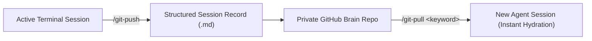

# 🧠 Git Second Brain Workflow

> Turn a private GitHub repository into permanent, structured, cross-session memory for AI coding agents (Antigravity CLI, OpenCode, Claude Code, Cursor, and Termux/PRoot).

[](LICENSE)
[](#)
[](#)

---

## 💡 The Problem: AI Coding Agent Context Amnesia

Terminal and CLI coding agents are extraordinarily capable, but suffer from a fatal flaw: **every time a session ends or terminal restarts, all memory evaporates**.

- **Lost Architectural Context:** Agents forget *why* specific architectural decisions, refactors, or fixes were chosen.
- **Wasted Tokens & Time:** Developers spend 15–30 minutes repeatedly explaining background context, project setups, and past debugging sessions.
- **Fragmented Environments:** Switching between a desktop, laptop, or mobile environment (e.g. Android Termux/PRoot) leaves your agent completely blind to previous progress.

---

## ⚡ The Solution: Git Second Brain

The **Git Second Brain Workflow** decouples session memory from ephemeral agent processes by storing persistent, human-readable, structured Markdown records in a private GitHub repository (`second-brain` or `antigravity-BRAIN`).



- **`/git-push`**: Captures the entire conversation arc from Message #1 into a rich 4-section Markdown document (> 500 bytes), copies artifacts, updates the master `README.md` index table, and pushes to GitHub.
- **`/git-pull`**: Synchronizes remote changes and either provides a clean overview of recent sessions (Mode A) or performs deep keyword ranking (Mode B) to hydrate active memory in seconds.
- **Zero Storage Bloat:** Markdown files maintain a tiny disk footprint while shallow fetches (`--depth 1`) eliminate massive Git history overhead on mobile and low-storage machines.

---

## 📂 Repository Structure

```
git-2nd-brain-workflow/
├── README.md                   # System blueprint & documentation
├── skills/
│   ├── git-push/
│   │   └── SKILL.md            # Reusable /git-push skill definition
│   └── git-pull/
│       └── SKILL.md            # Reusable /git-pull skill definition
└── docs/
    ├── git-push-explained.md   # Deep dive into session narrative export & indexing
    └── git-pull-explained.md   # Deep dive into keyword recall & memory hydration
```

---

## 🚀 The `/git-push` Component

The `/git-push` skill extracts the full narrative arc from your active conversation and commits it to your private Second Brain repository.

### How to Trigger:
- `/git-push`
- `/git push`
- `save session to brain`
- `sync session narrative to second brain`

### The 4 Required Sections (Integrity Gate):
Every exported session is required to exceed 500 bytes and contain all four populated sections:
1. `## Session Story & User Intent`: 2–3 narrative paragraphs explaining what the user set out to do and why decisions were made.
2. `## Complete Chronological Workflow`: Step-by-step breakdown of actions taken.
3. `## Key Milestones, Repos & Technical Decisions`: Concrete repository names, commit SHAs, file paths, and architectural choices.
4. `## Searchable Context & Notes`: Keywords, tools, commands, and concepts engineered for accurate `/git-pull <keyword>` recall.

### Automatic Master Indexing
When `/git-push` executes, it automatically updates the `README.md` table in your private brain repository:
```markdown
| Date | Session ID | Title | File |
| :--- | :--- | :--- | :--- |
| 2026-11-19 11:25:00 | `fb2dcfc3` | Install GitHub Actions Build APK Global Skill | [20261119_fb2dcfc3_Install_GitHub_Actions_Build_APK_Global_Skill.md](sessions/20261119_fb2dcfc3_Install_GitHub_Actions_Build_APK_Global_Skill.md) |
```

For the complete technical breakdown, read [docs/git-push-explained.md](docs/git-push-explained.md).

---

## 📄 License
MIT License. Free to use, adapt, and share.
