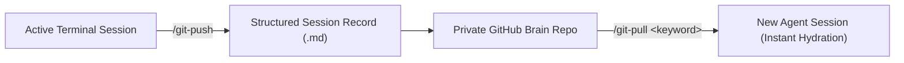

# 🧠 Git Second Brain Workflow

> Turn a private GitHub repository into permanent, structured, cross-session memory for AI coding agents (Antigravity CLI, OpenCode, Claude Code, Cursor, and Termux/PRoot).

[](#)
[](#)
[](#)

---

## ⚡ Quick Start: Copy-Paste Prompt for Your Coding Agent

You don't need to configure directories or write scripts manually. Copy the prompt below, paste it directly into your AI coding agent (Antigravity CLI, OpenCode, Claude Code, or Cursor), and hit Enter:

```markdown
Please set up the Git Second Brain workflow on this machine using https://github.com/spot0mee/git-2nd-brain-workflow:

1. Verify Prerequisites:
   - Check `gh auth status` to ensure GitHub CLI is logged in.
   - Verify `git config user.name` and `git config user.email` are configured.

2. Create My Private Second Brain Repository:
   - Check if a private repository named `second-brain` exists under my GitHub account.
   - If not, create it privately via GitHub CLI:
     gh repo create second-brain --private --description "Private AI agent second brain memory"
   - Clone or initialize it locally at `~/second-brain` on branch `main`.
   - Ensure the standard directory structure exists:
     mkdir -p ~/second-brain/sessions ~/second-brain/artifacts ~/second-brain/tasks ~/second-brain/context
   - If `~/second-brain/README.md` does not exist, initialize it with a session index table:
     ```markdown
     # Second Brain
     Private cross-session memory repository for AI coding agents.
     - **Owner**: $(gh api user -q .login 2>/dev/null || echo "User")
     - **Branch**: main
     - **Total Synced Sessions**: 0
     - **Last Synced**: $(date -u +"%Y-%m-%d %H:%M:%S UTC")

     ## Recent Sessions
     | Date | Session ID | Title | File |
     | :--- | :--- | :--- | :--- |
     ```
   - Commit and push the initial structure to `origin main` if newly created.

3. Install /git-push and /git-pull Skills:
   - Download the official skill definitions from `spot0mee/git-2nd-brain-workflow`:
     mkdir -p ~/.agents/skills/git-push ~/.agents/skills/git-pull
     curl -fsSL https://raw.githubusercontent.com/spot0mee/git-2nd-brain-workflow/main/skills/git-push/SKILL.md -o ~/.agents/skills/git-push/SKILL.md
     curl -fsSL https://raw.githubusercontent.com/spot0mee/git-2nd-brain-workflow/main/skills/git-pull/SKILL.md -o ~/.agents/skills/git-pull/SKILL.md

4. Wire Up Global Symlinks Across Agents:
   - Link the skills into all agent discovery paths (`~/.agents/skills/`, `~/.gemini/skills/`, `~/.claude/skills/`):
     for dir in ~/.gemini/skills ~/.claude/skills; do
       if [ -d "$(dirname "$dir")" ]; then
         mkdir -p "$dir"
         ln -sfn ~/.agents/skills/git-push "$dir/git-push"
         ln -sfn ~/.agents/skills/git-pull "$dir/git-pull"
         ln -sfn ~/.agents/skills/git-push "$dir/git_push"
         ln -sfn ~/.agents/skills/git-pull "$dir/git_pull"
       fi
     done
     ln -sfn ~/.agents/skills/git-push ~/.agents/skills/git_push
     ln -sfn ~/.agents/skills/git-pull ~/.agents/skills/git_pull

5. Verify Installation:
   - Confirm the skills are linked and print a confirmation showing that `/git-push` and `/git-pull` are active and ready.
```

---

## 🔑 Prerequisites Guide

Before running the setup prompt or manual installer, make sure your local environment is authenticated with GitHub:

### 1. GitHub CLI Authentication
```bash
# Check if already authenticated:
gh auth status

# If not authenticated, log in:
gh auth login
```
Select **GitHub.com**, choose your preferred protocol (**SSH** recommended, or **HTTPS**), and authenticate via web browser or personal access token.

### 2. Git Identity Configuration
Ensure Git knows your name and email for commits:
```bash
git config --global user.name "Your Name"
git config --global user.email "your_email@example.com"
```
*(If you have GitHub Email Privacy enabled, use your noreply email: `ID+username@users.noreply.github.com`).*

---

## 💡 The Problem: AI Coding Agent Context Amnesia

Terminal coding agents lose their working memory the moment a session closes:
- **Lost Architectural Rationale:** The agent forgets why a specific design pattern, library version, or bug workaround was chosen.
- **Wasted Time & Tokens:** Developers spend significant time repeatedly briefing the agent on background context.
- **Multi-Device Disconnect:** Switching between a desktop, laptop, or mobile environment (Android Termux/PRoot) leaves the agent blind to earlier progress.

---

## ⚡ The Solution: Git Second Brain

The **Git Second Brain Workflow** decouples session memory from ephemeral agent processes. It turns a private GitHub repository into structured, searchable Markdown memory:



- **`/git-push`**: Reconstructs the complete conversation arc from Message #1 into a rich 4-section Markdown document (> 500 bytes), preserves artifacts, prepends to the master `README.md` table, and pushes to GitHub.
- **`/git-pull`**: Syncs remote memory across devices and either provides a clean overview of recent work (Mode A) or executes deep keyword relevance ranking (Mode B) to hydrate active memory in seconds.
- **Zero Storage Bloat:** Session records are lightweight Markdown files. Shallow git operations (`--depth 1`) eliminate massive historical commit bloat on mobile and low-storage machines.

---

## ⚖️ Workflow Comparison: `/git-push` vs `/git-pull`

| Feature | `/git-push` | `/git-pull` |
| :--- | :--- | :--- |
| **Primary Purpose** | Session narrative serialization & export | Session memory recall & context hydration |
| **When to Trigger** | At the end of a session, before exit, or after key milestones | At the start of a session or when switching topics |
| **Arguments** | None (reads full conversation history automatically) | Optional query or keyword (e.g. `/git-pull apk-build`) |
| **Integrity Gate** | File exists, `> 500 bytes`, all 4 sections non-empty | Pulls remote, ranks top 1–3 matches, ingests full content |
| **Remote Action** | Pulls `--rebase`, commits with semantic message, pushes | `git pull origin main` to synchronize multi-device edits |
| **Triggers** | `/git-push`, `/git push`, `save session to brain` | `/git-pull`, `/git pull`, `/git-pull <keyword>` |

---

## 🚀 The `/git-push` Workflow

### Triggers:
- `/git-push`
- `/git push`
- `save session to brain`

### The 4 Required Sections (Integrity Gate):
Every exported session record is validated by an automated integrity gate before any git command is executed:
1. `## Session Story & User Intent`: 2–3 paragraphs in narrative form capturing the user's initial objective, the journey of steps, and key rationale.
2. `## Complete Chronological Workflow`: Numbered step-by-step breakdown of what was investigated, created, or tested.
3. `## Key Milestones, Repos & Technical Decisions`: Concrete repository names, commit SHAs, file paths, and architectural choices.
4. `## Searchable Context & Notes`: Keywords, tools, commands, and concepts engineered for accurate `/git-pull <keyword>` recall.

### Master Indexing in `README.md`
When `/git-push` runs, it automatically prepends the new session into the `README.md` table in your private brain:
```markdown
| Date | Session ID | Title | File |
| :--- | :--- | :--- | :--- |
| 2026-11-19 11:25:00 | `fb2dcfc3` | Install GitHub Actions Build APK Global Skill | [20261119_fb2dcfc3_Install_GitHub_Actions_Build_APK_Global_Skill.md](sessions/20261119_fb2dcfc3_Install_GitHub_Actions_Build_APK_Global_Skill.md) |
```

For the complete technical breakdown, read [docs/git-push-explained.md](docs/git-push-explained.md).

---

## 🔄 The `/git-pull` Workflow

### Triggers:
- `/git-pull` (Mode A: Overview of recent sessions)
- `/git-pull <keyword>` or `/git-pull <phrase>` (Mode B: Deep keyword search & ranking)

### Mode A: Overview (No Keyword)
- Runs `git pull origin main` to sync remote changes.
- Reads `README.md` and the 5 most recent files in `sessions/`.
- Presents a structured overview of recent work and prompts where to resume.

### Mode B: Deep Keyword Recall (`/git-pull <query>`)
- Searches across all files in `sessions/` and `artifacts/`.
- Ranks matches using weighted relevance:
  - Exact match in `# Title`: `+100`
  - Exact match in `Tags`: `+80`
  - Exact match in `Filename`: `+50`
  - Exact phrase in `Session Story` or `Notes`: `+50` to `+60`
  - Individual keyword occurrences: `+10` per hit
  - Recency timestamp: Tie-breaker
- Reads the full Markdown of the top 1–3 matching session files.
- Ingests that historical context into active memory and gives you a summary before continuing.

For the complete technical breakdown, read [docs/git-pull-explained.md](docs/git-pull-explained.md).

---

## 📂 Repository Structure

```
git-2nd-brain-workflow/
├── README.md                   # Blueprint & agent installer prompt
├── install.sh                  # One-line global symlink installer
├── skills/
│   ├── git-push/
│   │   └── SKILL.md            # Reusable /git-push skill definition
│   └── git-pull/
│       └── SKILL.md            # Reusable /git-pull skill definition
├── docs/
│   ├── git-push-explained.md   # Full-arc reconstruction & zero-bloat indexing
│   └── git-pull-explained.md   # Remote sync & relevance ranking formula
└── templates/
    └── brain-README.md         # Starter README for your private brain repo
```

---

## 💻 Manual Installation (Direct CLI)

If you prefer installing directly from your shell:

```bash
# Clone the repository
git clone --depth 1 https://github.com/spot0mee/git-2nd-brain-workflow.git ~/.agents/skills/git-2nd-brain-workflow

# Run the installer script
bash ~/.agents/skills/git-2nd-brain-workflow/install.sh
```

---

## 📄 License
MIT License. Free to use, adapt, and share.
