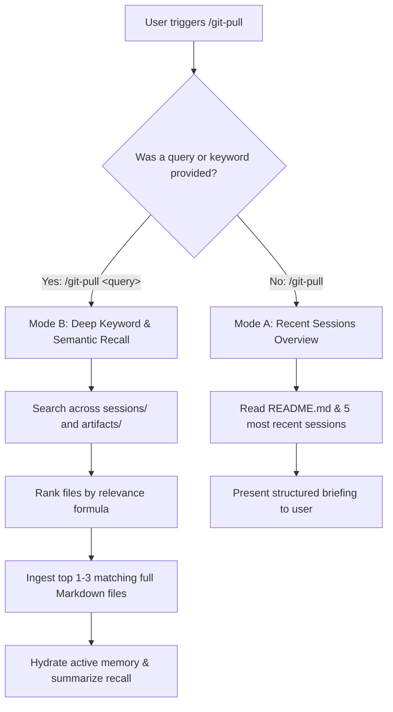

# Deep Dive: How `/git-pull` Hydrates AI Agent Memory

When starting a new conversation with an AI coding agent (in a new terminal tab, after a reboot, or on a different device), the agent has zero memory of previous sessions. Without memory recall, you are forced to re-explain project architecture, library choices, past debugging insights, and configuration decisions.

The `/git-pull` skill solves context amnesia by dynamically retrieving past session knowledge from your private Git Second Brain repository and injecting it into the agent's active working memory.

---

## 1. Remote Synchronization Across Devices

Because the Second Brain repository lives on GitHub as a private repository, you can switch seamlessly between devices:
- Start a feature on your desktop.
- Run `/git-push` at the end of the session.
- Pick up your laptop or mobile device (Android Termux/PRoot).
- Trigger `/git-pull`—the agent pulls the latest commit from `origin/main` before performing any recall operation:

```bash
git -C "$BRAIN_PATH" pull origin main
```

This guarantees your agent always reads the freshest state across all your active environments.

---

## 2. Two Operating Modes: Overview vs. Deep Keyword Recall

`/git-pull` intelligently branches into two distinct operational modes based on user input:



---

## 3. Mode A: No Keyword (`/git-pull`)

When you run `/git-pull` without arguments, the agent provides an executive briefing of your recent work:

1. **Reads the Master Index:** Parses `README.md` to see total sessions and recent sync timestamps.
2. **Inspects Top 5 Recent Files:** Reads the 5 most recent markdown files in `sessions/`.
3. **Presents a Structured Dashboard:**
   - Session Title, Date, and ID.
   - Core tags and topics.
   - The primary problem solved in that session (extracted from `## Session Story & User Intent`).
   - Major technical decisions.
4. **Resumption Options:** Prompts you to pick up where you left off or dive deeper into any specific session.

---

## 4. Mode B: Keyword or Phrase Recall (`/git-pull <query>`)

When you run `/git-pull <query>` (e.g. `/git-pull apk-build`, `/git-pull auth0 migration`, `/git-pull postgres connection pooling`), the agent performs a deep full-text search and relevance ranking across every session file and artifact.

### The Relevance Ranking Formula:

| Match Type | Weight / Score Impact | Why It Matters |
| :--- | :--- | :--- |
| **Exact Query in `# Title`** | `+100` | The session was directly dedicated to this topic. |
| **Exact Query in `Tags`** | `+80` | High-intent architectural label assigned during push. |
| **Exact Query in Filename** | `+50` | Explicit naming signal. |
| **Exact Phrase in `Session Story` or `Notes`** | `+50` to `+60` | Found verbatim in the narrative or technical notes. |
| **Individual Keyword Hits in `Session Story`** | `+10` per occurrence (up to +50) | Indicates substantial thematic relevance. |
| **Individual Keyword Hits in `Searchable Context`** | `+10` per occurrence (up to +50) | Found in command notes, tool names, or bug remedies. |
| **Timestamp Recency** | Tie-breaker | Newer sessions take precedence when relevance scores match. |

### Memory Ingestion & Hydration:
Once the top 1–3 highest-scoring session files are identified:
1. The agent reads the **entire Markdown content** of those files.
2. The past context—including exact file paths, past bugfixes, library versions, and architectural rationale—is ingested into the active conversation context.
3. The agent outputs a clear summary of what was recalled to the user:
   - **Session Title & Timestamp**
   - **Recalled Story & Intent**
   - **Key Decisions & Artifacts**
4. The agent immediately continues addressing the user's ongoing prompt with full historical memory restored.
