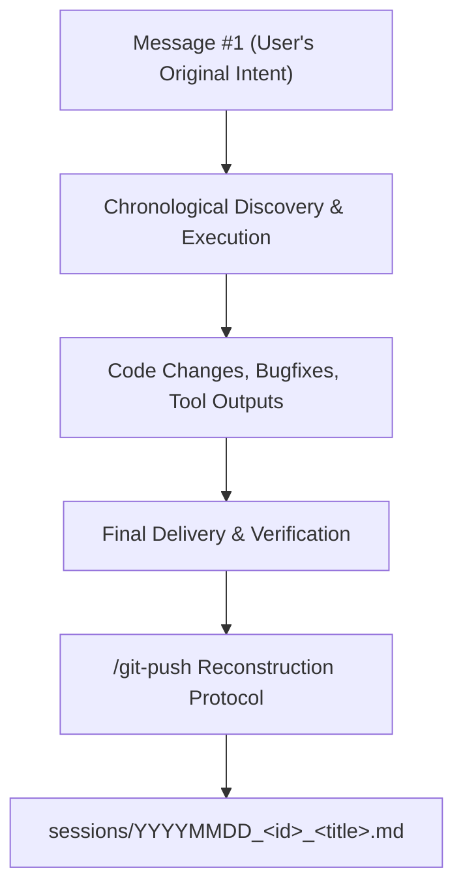

# Deep Dive: How `/git-push` Powers AI Session Memory

When AI coding agents (such as Antigravity CLI, OpenCode, Claude Code, or Cursor) operate in terminal and cloud environments, their biggest bottleneck is **context amnesia**. When a terminal session ends or a context window compacts, the agent forgets what was built, why architectural decisions were made, and which bugs were solved.

The `/git-push` skill solves this by turning a private GitHub repository into a durable, structured **Second Brain**. Instead of storing raw conversation dumps that blow through token limits, `/git-push` captures an intelligent, highly searchable narrative of the entire session and syncs it to the cloud.

---

## 1. Full-Arc Reconstruction: How Sessions Become Structured Markdown

Most basic session exporters make the fatal mistake of summarizing only the last few messages or generating a shallow 2-sentence summary. When another agent attempts to read that context days later, it lacks the technical depth needed to resume work.

`/git-push` executes a **full-arc reconstruction protocol**:



### The 4 Required Narrative Sections

Every session document must pass an **Integrity Gate** (> 500 bytes with zero empty sections) before Git is ever touched. The document is divided into four critical sections:

1. **`## Session Story & User Intent`**
   - Written as a 2–3 paragraph narrative.
   - Explains the starting problem, the user's ultimate goal, why specific pathways were chosen, and what roadblocks were encountered.
   - This provides the "why" that raw Git diffs cannot convey.

2. **`## Complete Chronological Workflow`**
   - A step-by-step numbered breakdown (`1. Initial Setup`, `2. Core Execution`, `3. Finalization`).
   - Details every major action taken: repositories cloned, dependencies installed, configs adjusted, and tests executed.

3. **`## Key Milestones, Repos & Technical Decisions`**
   - Bulleted list of exact file paths, GitHub URLs, commit hashes, and architectural design patterns.
   - Ensures any agent reading this later has concrete pointers to exact resources.

4. **`## Searchable Context & Notes`**
   - Plain-English keywords, CLI commands, specific library versions, error messages, and prompt phrases.
   - Specifically engineered to maximize BM25 / full-text keyword ranking when recalled via `/git-pull <keyword>`.

### Associated Artifacts Handling

If the session generated complex markdown artifacts, diagrams, or architectural plans in the agent's transient artifact storage (e.g., `<appDataDir>/brain/<conversation-id>/`), `/git-push` automatically copies them to `artifacts/<short_session_id>/` in your brain repository and creates relative links in the session document.

---

## 2. Automatic Master Indexing: The `README.md` Table

Your Second Brain repository's root `README.md` acts as an executive dashboard. Instead of manually editing tables, `/git-push` updates the master index automatically:

```markdown
- **Total Synced Sessions**: 42
- **Last Synced**: 2026-11-19 11:25:00 UTC

## Recent Sessions

| Date | Session ID | Title | File |
| :--- | :--- | :--- | :--- |
| 2026-11-19 11:25:00 | `fb2dcfc3` | Install GitHub Actions Build APK Global Skill | [20261119_fb2dcfc3_Install_GitHub_Actions_Build_APK_Global_Skill.md](sessions/20261119_fb2dcfc3_Install_GitHub_Actions_Build_APK_Global_Skill.md) |
| 2026-11-17 03:22:00 | `395423b6` | Build My Agent Skills Catalog & Production Release | [20261116_395423b6_Build_My_Agent_Skills_Catalog_and_Intelligent_Ephe.md](sessions/20261116_395423b6_Build_My_Agent_Skills_Catalog_and_Intelligent_Ephe.md) |
```

### How the Indexer Works:
1. **Atomic Prepend:** Newly synced sessions are always prepended directly below the table header row (`| :--- |`), ensuring the latest work is immediately visible at the top.
2. **Metadata Increment:** `- **Total Synced Sessions**:` is dynamically updated by counting all markdown records in `sessions/`.
3. **Timestamp Refresh:** `- **Last Synced**:` records the exact UTC timestamp of the commit.

---

## 3. Zero-Storage-Bloat & Shallow Syncing

### The Problem on Mobile & Resource-Constrained Environments
Developers running AI agents on mobile environments (Android via Termux or PRoot Ubuntu), cloud instances, or lightweight laptops face severe disk constraints:
- Traditional Git repositories store object trees, commit packs, and historical blobs that grow by hundreds of megabytes.
- Re-cloning or maintaining massive commit histories can cause PRoot crashes or fill internal mobile storage.

### How Git Second Brain Eliminates Bloat

1. **Pure Markdown Footprint:**
   Because session records and artifacts are clean, plain-text Markdown files, thousands of sessions occupy only a few megabytes on disk.
2. **Shallow Fetch & Rebase:**
   When pulling or pushing, the workflow uses shallow operations:
   ```bash
   git fetch --depth 1 origin main
   git pull --rebase origin main
   ```
   This synchronizes only the latest state without downloading full commit histories.
3. **Dedicated Separation of Concerns:**
   Your coding project repositories stay completely decoupled from your memory repository. Your project code repository (`my-cool-app`) only contains code, while your Second Brain (`second-brain`) stores session history. This prevents cluttering production code with agent discussion transcripts.

---

## 4. Verification Gate: Preventing Corrupt Syncs

Before running `git add`, `git commit`, or `git push`, `/git-push` enforces a strict verification gate:

```bash
# Pseudocode verification logic:
1. Verify file exists on disk
2. Verify file size > 500 bytes
3. Verify presence of all 4 required section headers
4. Verify sections contain non-empty narrative text
5. If any check fails -> STOP and report error
```

This prevents common AI failure modes:
- Syncing empty "Untitled Session" files.
- Syncing truncated files caused by incomplete tool output.
- Syncing shallow one-liners that fail to provide actionable context for future sessions.

Once the gate passes, changes are staged, committed with a standardized semantic commit (`sync(brain): <Title> (<short_session_id>)`), and pushed to GitHub.
